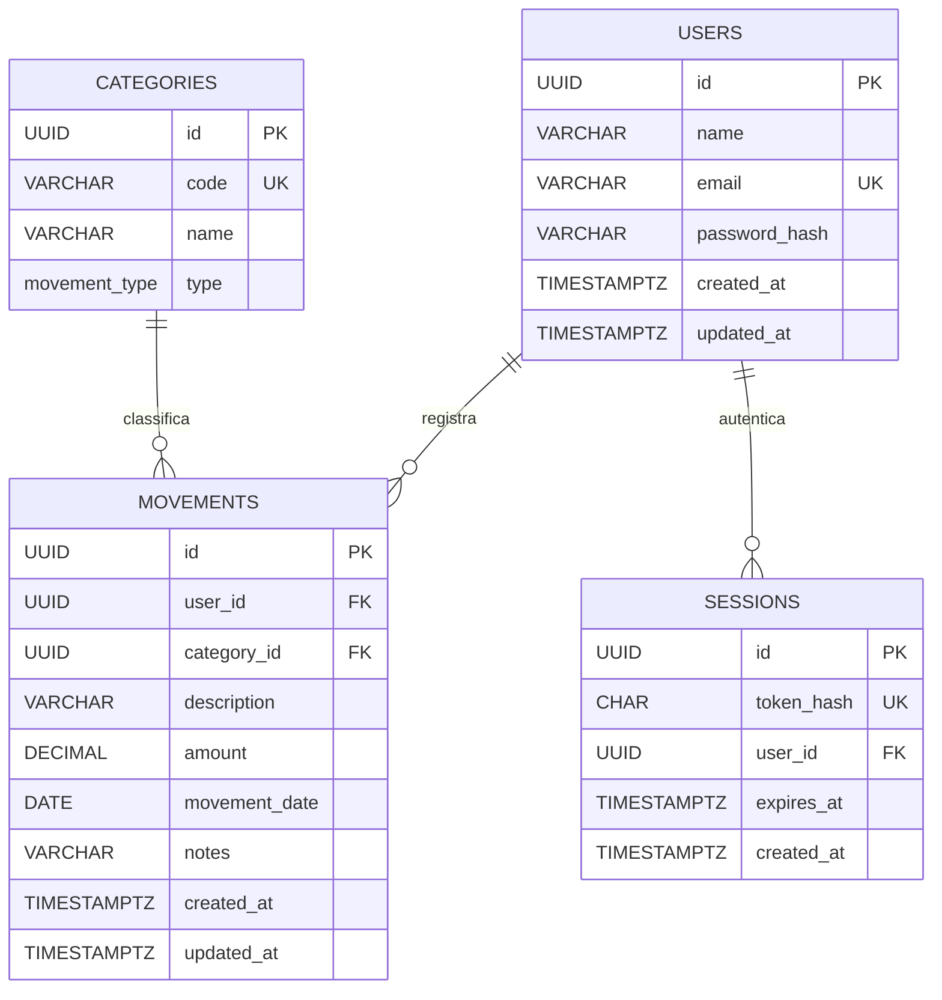

# FinTrack — modelagem do banco de dados

## Decisões do MVP

- PostgreSQL como banco relacional e Prisma como ORM.
- Uma única moeda (BRL); o valor não guarda um código de moeda por movimentação.
- Categorias predefinidas e compartilhadas entre os usuários. A primeira migração as cadastra.
- O saldo não é armazenado: o saldo atual é acumulado até hoje e o saldo mensal considera o período selecionado.
- Não há contas bancárias ou saldo inicial nesta versão.

## Entidades

### `users`

| Coluna | Tipo PostgreSQL | Nulo? | Regra |
|---|---|---:|---|
| `id` | `UUID` | Não | Chave primária, gerada pela aplicação |
| `name` | `VARCHAR(100)` | Não | Nome não pode ser vazio |
| `email` | `VARCHAR(254)` | Não | Único; a aplicação deve salvar em minúsculas |
| `password_hash` | `VARCHAR(255)` | Não | Hash da senha, nunca a senha em texto puro |
| `created_at` | `TIMESTAMPTZ(3)` | Não | Criado com o registro |
| `updated_at` | `TIMESTAMPTZ(3)` | Não | Atualizado pelo Prisma |

### `sessions`

| Coluna | Tipo PostgreSQL | Nulo? | Regra |
|---|---|---:|---|
| `id` | `UUID` | Não | Chave primária |
| `token_hash` | `CHAR(64)` | Não | Hash SHA-256 único do token; o token puro fica apenas no cookie |
| `user_id` | `UUID` | Não | Chave estrangeira para `users.id` |
| `expires_at` | `TIMESTAMPTZ(3)` | Não | Prazo de validade da sessão |
| `created_at` | `TIMESTAMPTZ(3)` | Não | Instante em que a sessão foi criada |

### `categories`

| Coluna | Tipo PostgreSQL | Nulo? | Regra |
|---|---|---:|---|
| `id` | `UUID` | Não | Chave primária |
| `code` | `VARCHAR(32)` | Não | Código estável e único, usado para identificar a categoria |
| `name` | `VARCHAR(60)` | Não | Nome exibido; único junto com `type` |
| `type` | `movement_type` | Não | `income` ou `expense` |

As categorias iniciais são Salário, Freelance, Investimentos e Outros para receitas; Moradia, Alimentação, Transporte, Saúde, Lazer e Outros para despesas.

### `movements`

| Coluna | Tipo PostgreSQL | Nulo? | Regra |
|---|---|---:|---|
| `id` | `UUID` | Não | Chave primária |
| `user_id` | `UUID` | Não | Chave estrangeira para `users.id` |
| `category_id` | `UUID` | Não | Chave estrangeira para `categories.id`; o tipo é obtido pela categoria |
| `description` | `VARCHAR(120)` | Não | Descrição não pode ser vazia |
| `amount` | `DECIMAL(12,2)` | Não | Valor positivo, com precisão exata de centavos |
| `movement_date` | `DATE` | Não | Dia da movimentação, sem horário/fuso |
| `notes` | `VARCHAR(500)` | Sim | Observação opcional |
| `created_at` | `TIMESTAMPTZ(3)` | Não | Instante em que o registro foi criado |
| `updated_at` | `TIMESTAMPTZ(3)` | Não | Instante da última alteração |

O enum `movement_type` limita os valores a `income` e `expense`.

## DER



O tipo da movimentação é o tipo de sua categoria. Assim, não há uma segunda coluna `type` em `MOVEMENTS` para ficar divergente; o backend filtra as categorias compatíveis com o tipo escolhido no formulário.

## Relacionamentos e cardinalidade

- **Usuário 1:N Movimentações:** um usuário pode não ter ou ter várias movimentações; cada movimentação pertence a exatamente um usuário. A exclusão do usuário remove suas movimentações (`ON DELETE CASCADE`).
- **Usuário 1:N Sessões:** um usuário pode ter várias sessões; cada sessão pertence a exatamente um usuário e é removida junto com ele.
- **Categoria 1:N Movimentações:** uma categoria pode classificar nenhuma ou várias movimentações; cada movimentação tem exatamente uma categoria. Uma categoria em uso não pode ser excluída (`ON DELETE RESTRICT`).
- Não existe relacionamento direto entre usuários e categorias: as categorias iniciais são compartilhadas.

## Normalização e integridade

O modelo atende à **3ª Forma Normal** para o escopo atual:

- Dados de autenticação ficam em `users`, os nomes e tipos das categorias em `categories`, e os lançamentos em `movements`.
- Cada movimentação guarda apenas as chaves das entidades relacionadas, não repete nome de usuário ou categoria.
- `type` fica em `categories`, onde define se aquele lançamento é receita ou despesa. As consultas fazem `JOIN` para filtrar e agregar pelo tipo.
- O saldo não é duplicado em uma coluna. Assim, uma edição ou exclusão não deixa um saldo armazenado desatualizado.

As restrições são aplicadas em mais de uma camada:

- `PRIMARY KEY`, `FOREIGN KEY`, `UNIQUE` e `NOT NULL` protegem identidade e relações.
- O enum limita os tipos de movimentação.
- A migração inicial adiciona `CHECK` para valor maior que zero e nomes/descrições não vazios.
- O backend valida tamanho, formato dos valores/datas/categorias e normaliza e-mail para minúsculas.
- Senhas são armazenadas com scrypt; sessões usam tokens aleatórios em cookie `HttpOnly`, enquanto somente o hash do token é persistido.
- Toda leitura, edição ou exclusão de movimentação deve filtrar pelo `user_id` da sessão autenticada. Não se deve confiar em um `user_id` enviado livremente pelo navegador.
- A aplicação usa BRL em todo o MVP. Se moedas forem adicionadas futuramente, será necessário persistir a moeda e definir regras cambiais.

Os índices em `(user_id, movement_date)` e `category_id` atendem à listagem por período e às junções com categorias, mantendo as consultas sempre limitadas ao usuário autenticado.

## Consultas na aplicação

O Prisma deve ser a interface normal do backend para essas tabelas. SQL parametrizado é útil para entender as operações e para relatórios especializados; nunca concatene valores recebidos do usuário na string SQL.

### Listar por usuário, período e tipo opcional

```sql
SELECT
    m.id,
    m.description,
    c.type,
    m.amount,
    m.movement_date,
    c.name AS category
FROM movements AS m
JOIN categories AS c
  ON c.id = m.category_id
WHERE m.user_id = $1
  AND m.movement_date >= $2::date
  AND m.movement_date <= $3::date
  AND ($4::movement_type IS NULL OR c.type = $4::movement_type)
ORDER BY m.movement_date DESC, m.created_at DESC
LIMIT $5 OFFSET $6;
```

O primeiro e o último dia são incluídos. Para o dashboard mensal, `$2` é o primeiro dia do mês e `$3` é o último.

### Calcular indicadores do dashboard

Uma única consulta agrega no PostgreSQL em `DECIMAL`, sem converter valores monetários para ponto flutuante. `$1` é o usuário da sessão, `$2` é o primeiro dia do mês selecionado, `$3` é o primeiro dia do mês seguinte (limite exclusivo), e `$4` é a data atual em `America/Sao_Paulo`.

```sql
SELECT
    COALESCE(SUM(m.amount) FILTER (
        WHERE c.type = 'income'
          AND m.movement_date >= $2::date
          AND m.movement_date < $3::date
    ), 0) AS monthly_income,
    COALESCE(SUM(m.amount) FILTER (
        WHERE c.type = 'expense'
          AND m.movement_date >= $2::date
          AND m.movement_date < $3::date
    ), 0) AS monthly_expense,
    COALESCE(SUM(m.amount) FILTER (
        WHERE c.type = 'income' AND m.movement_date <= $4::date
    ), 0) AS current_income,
    COALESCE(SUM(m.amount) FILTER (
        WHERE c.type = 'expense' AND m.movement_date <= $4::date
    ), 0) AS current_expense
FROM movements AS m
JOIN categories AS c ON c.id = m.category_id
WHERE m.user_id = $1
  AND (
      m.movement_date <= $4::date
      OR (m.movement_date >= $2::date AND m.movement_date < $3::date)
  );
```

O saldo atual é `current_income - current_expense`, considerando todas as movimentações até hoje e excluindo datas futuras. O saldo do mês selecionado é `monthly_income - monthly_expense`; ambos são distintos. Os totais são convertidos para centavos inteiros depois da agregação e a API retorna erro caso excedam o limite inteiro seguro do JavaScript.

O endpoint autenticado `GET /api/summary?month=AAAA-MM` fornece esses quatro indicadores. O seletor existente da interface escolhe o mês e o ano dos três valores mensais. Após criar, editar ou excluir uma movimentação, o Dashboard consulta novamente o resumo. A rota usa SQL parametrizado e limita todos os dados ao usuário da sessão.

O fluxo de caixa (6 ou 12 meses até o mês selecionado) e a distribuição de despesas por categoria são calculados a partir da lista de movimentações já carregada pela API autenticada `GET /api/movements`; as agregações usam centavos inteiros e são recalculadas após as operações do CRUD. Não há filtro por conta/cartão porque as movimentações ainda não pertencem a contas separadas. Orçamentos, metas e datas de vencimento aparecem como indisponíveis: esses dados ainda não existem no modelo.

### Criar, editar e excluir

- **Create:** `INSERT` em `movements` com uma categoria do tipo escolhido.
- **Read:** `SELECT` por `user_id`, com filtros opcionais e ordenação por data.
- **Update:** `UPDATE ... WHERE id = $1 AND user_id = $2`; verificar se uma linha foi alterada.
- **Delete:** `DELETE ... WHERE id = $1 AND user_id = $2`, somente após confirmação do usuário.

No Prisma, essas operações correspondem a `create`, `findMany`, `update` e `delete`. As operações de edição e exclusão sempre incluem o usuário autenticado no filtro; um registro de outra conta responde como não encontrado.

## API REST implementada

| Método | Rota | Responsabilidade |
|---|---|---|
| `POST` | `/api/auth/register` | Criar conta e iniciar sessão |
| `POST` | `/api/auth/login` | Validar credenciais e iniciar sessão |
| `GET` | `/api/auth/session` | Consultar a conta da sessão atual |
| `POST` | `/api/auth/logout` | Revogar a sessão atual |
| `GET` | `/api/movements` | Listar movimentações do usuário autenticado |
| `POST` | `/api/movements` | Cadastrar movimentação |
| `GET` | `/api/summary?month=AAAA-MM` | Resumo mensal e saldo acumulado até hoje |
| `GET` | `/api/movements/{id}` | Consultar uma movimentação própria |
| `PUT` | `/api/movements/{id}` | Substituir os dados de uma movimentação própria |
| `DELETE` | `/api/movements/{id}` | Excluir uma movimentação própria |

O corpo de cadastro/edição recebe `description`, `amountCents` (inteiro em centavos), `type`, `date` (`AAAA-MM-DD`), `category` e `notes` opcional. Respostas de erro usam `{ "error": { "code": "...", "message": "...", "details": {} } }`. O navegador não escolhe o `user_id`; ele é obtido a partir da sessão validada no servidor.

Para executar no Windows, copie `.env.example` para `.env` (`Copy-Item .env.example .env`), ajuste `DATABASE_URL` e confirme que o serviço PostgreSQL está iniciado e que o banco/usuário da URL existem. Aplique as migrações com `npm run db:migrate` e inicie com `npm run dev`. Crie uma conta pela tela inicial e teste cadastro, consulta, edição e exclusão; recarregar a página confirma que as alterações foram persistidas. `npm test` executa os testes unitários de cálculos e validação.

## Arquivos da implementação

- `prisma/schema.prisma`: modelos, tipos e relacionamentos.
- `prisma/migrations/20261113215000_init/migration.sql`: criação das tabelas, restrições `CHECK` e categorias iniciais.
- `prisma/migrations/20261113223000_create_sessions/migration.sql`: criação da tabela de sessões.
- `prisma.config.ts`: configuração do Prisma CLI.
- `app/api/`: rotas de autenticação e movimentações.
- `lib/`: cliente Prisma, autenticação, validação e conversão de valores.
- `.env.example`: formato local esperado para `DATABASE_URL`; não contém credenciais reais.
